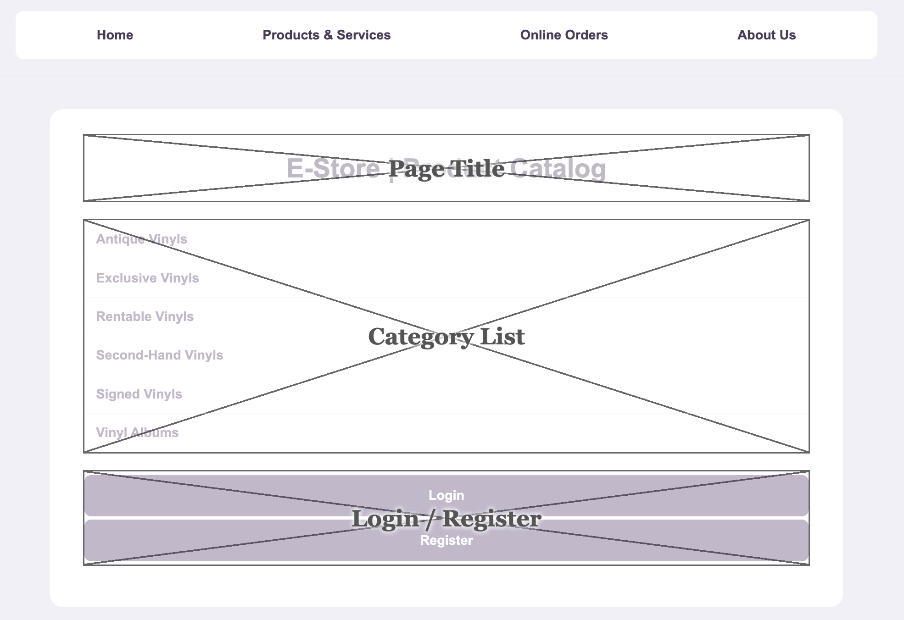
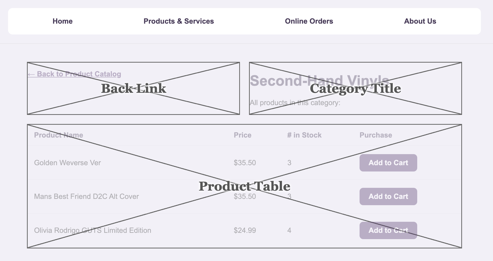
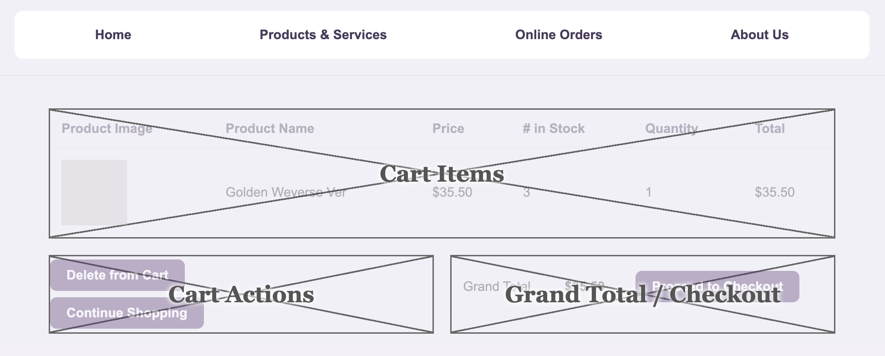
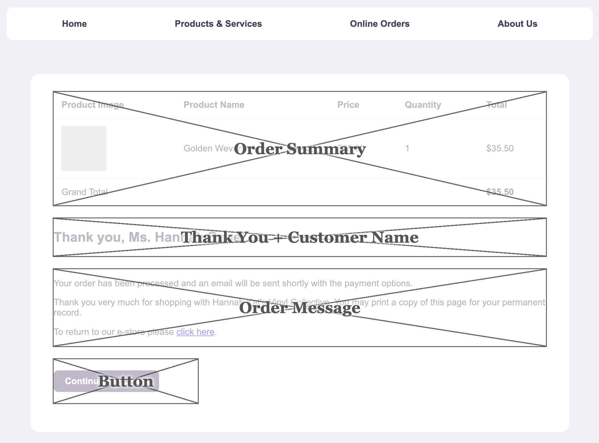

# Hannah Kat's Vinyl Collective

A multi-service music shop website for all things vinyl, with an online e-store connected to a product database.

## Physical Design & UI/UX

The following wireframes outline the journey of a customer through the e-store. Each page has been simplified to clearly show how each will look and what information will be present on each step.

**Product Catalogue → Category Page → Shopping Cart → Log In/Register → Order Confirmation**

### Wireframe 1: Product Catalogue

The customer selects a category in the product catalogue which pulls from the database. They can choose to Log In/Register.

### Wireframe 2: Category Page

The products in the category selected will be displayed with the name, price and stock amount. The customer will then click add to cart.

### Wireframe 3: Shopping Cart

The shopping cart will display the images of the items purchased along with the name, price and quantity. A total will also be displayed. The customer can then remove items, continue shopping or click checkout. If the customer hasn't logged in they will do so here.

### Wireframe 4: Order Confirmation

The customer will be shown a summary of the order. A thank you message will be displayed showing their name from their account. They will also be informed their payment email will be sent. There will also be a link back to the store.